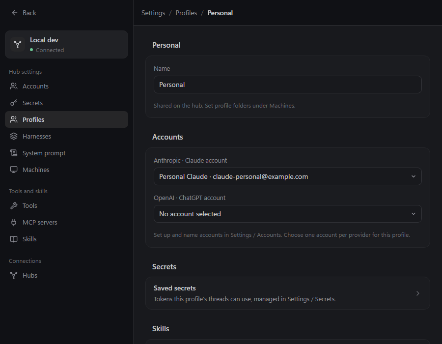
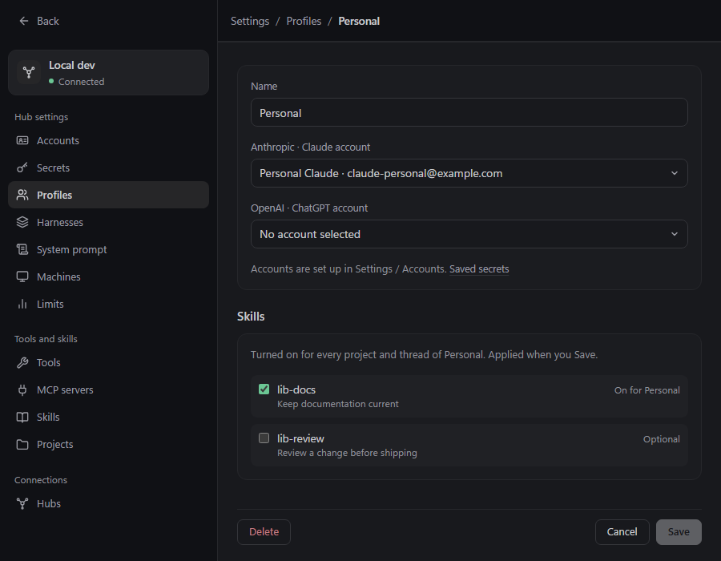
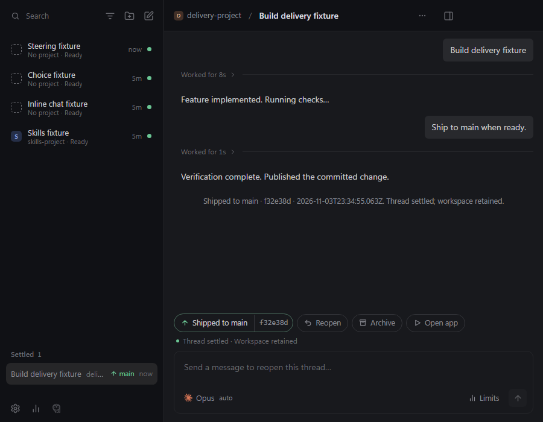
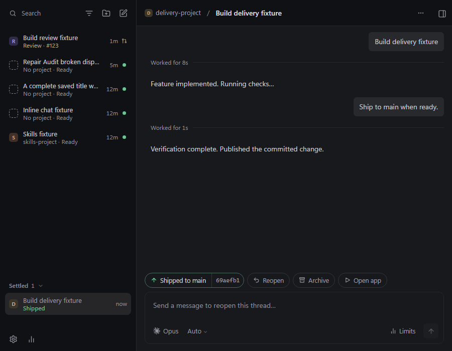

# UI audit comparison

Six completed independent audit rounds informed the changes on `ui_analysis`. Merge preparation was requested before round 7 completed. The latest independent scores describe `037f47b`; the subsequent fixes and integration with current main have implementation checks, but no final independent ratings.

## Changes visible in ordinary use

| Area | Before | Prepared for merge |
|---|---|---|
| Transcript | Raw resource JSON, receipts and repeated status interrupt reading. | Resource diagnostics leave the reading flow; delivery has one outcome chip and the current main delivery panel. Running messages remain visible as they arrive. |
| Delivery | Choosing a shipping mode immediately starts it. Stop wording implies tracking stops. | Selecting a mode stages it; the main button starts delivery and opens its panel. Stop automatic fixes explicitly keeps PR observation. |
| Settings | Different save/delete patterns and hidden project settings. | Shared footers, validation and confirmation; Projects and Limits in navigation; project shortcuts reach one editor. |
| Unsaved input | Navigation can discard typed edits. | Existing editors and all seven new-item forms guard Escape, breadcrumbs and section changes. Keep editing never saves; Discard persists nothing. |
| Profile editor | Cards push choices below the footer at 900 ? 700. | Compact account/name card and Saved secrets link keep choices visible. |
| Keyboard | Menus lack focus/arrow navigation; truncated titles cannot be read on focus. | Menus focus and support arrows/Escape; complete-title tooltips preserve row geometry; search/new-thread shortcuts. |
| Narrow window | Panes squeeze content and expose background controls. | Side panel overlays an inert background, traps focus, and releases it for Settings. |
| Composer | Early Enter can be lost; effort can reset; broken tools can leave orphan bubbles. | Early send works while machines load; effort saves immediately; refused sends retain drafts without publishing messages. Main?s immediate startup feedback is preserved. |
| Forms and feedback | Inconsistent validation, small targets and ambiguous copy feedback. | Field-local errors and focus, larger controls, file-specific media names, announced failures, clipboard acknowledgement/reset, onboarding Back. |

## Before / after screenshots

Curated evidence is versioned below; each pair uses a 900 ? 700 viewport. Before is round 1; after is round 6 (`037f47b`). Fixture contents differ. These demonstrate the audited improvements, not the later main integration or a pixel-difference test.

| Profile before | Profile after |
|---|---|
|  |  |

| Shipped thread before | Shipped thread after |
|---|---|
|  |  |

Full numbered screenshots, ARIA snapshots and traces remain locally under `out/ui-audit/round-N/<auditor>/`. The interactive local comparison is `out/ui-audit/comparison.html`. Reports preserve each audit's precise coverage and evidence qualifications.

## Latest independent scores

| Category | Sonnet | Opus | GPT Sol |
|---|---:|---:|---:|
| Minimalism / calmness | 9 | 9 | 9 |
| Hierarchy / typography | 9 | 9 | 9 |
| Consistency | 8 | 9 | 9 |
| Clarity / discoverability | 8 | 9 | 9 |
| Feedback / state | 9 | 9 | 9 |
| Efficiency / flow | 9 | 9 | 9 |
| Accessibility | 8 | 8 | 9 |
| Layout robustness | 9 | 9 | 9 |
| Forms / dialogs | 9 | 8 | 9 |

Round 1 scores ranged from 6?8. Round 6 used one saved build with matching served/disk manifest hashes. Later fixes address the remaining concrete findings, including new-form guards and navigation focus. The original all-auditor ?9 stopping criterion was not reached before the user requested merge preparation. Round 7 was stopped; the Claude audits hit rate limits.

Round 5 evidence has a shared-build qualification, documented in the reports and `round-5/plan.md`; round 6 corrected that process. Live provider sign-in and model turns, real hosting/CI, exhaustive screen-reader coverage and native OS integration remain outside the audit evidence. Scripted-provider and hosting boundaries are explicit in the tests. See [merge preparation](merge-preparation.md) for integration validation.
